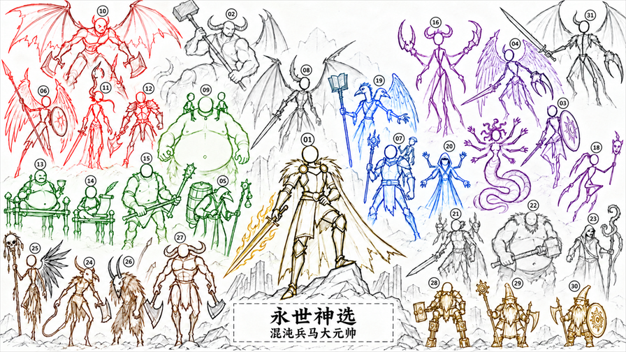

# 永世神选：混沌兵马大元帅

**Archaon: The Everchosen** 是以艾查恩为核心的《全面战争：战锤 III》战役模组。收服各族传奇领主，继承四神之力，将诺斯卡、混沌矮人与野兽人的军团纳入麾下，让永世神选率领一支真正的混沌联军。

## 主模组玩法

### 收服传奇领主，整编仆从军

在艾查恩原版收服机制的基础上，新增以下十位传奇领主：

| 种族 | 新增收服对象 |
| --- | --- |
| 诺斯卡 | 『流浪者』乌弗瑞克、索隆格、『无信者』萨尔 |
| 混沌矮人 | 阿斯特戈斯·铁手、『灰烬』德拉兹霍斯、『黑心』扎坦 |
| 野兽人 | 『独眼』卡扎克、『黑暗征兆』马拉戈、『影孽』魔古尔、『铜牛』陶诺斯 |

通过战后抉择收服领主；对应派系覆灭后，也可等待挑战机会。来源派系仍存活时，传奇领主加入艾查恩，剩余势力统一并入同族仆从军，接收其城镇与其他存活军队。

恶魔亲王也可收服，并保留身体部件与换装。加入艾查恩后，可献祭灵魂获取恶魔神耀、解锁部件与本队军团训练。

### 继承四神机制

实际取得对应传奇领主后，逐步解锁战前诱惑、费斯图斯版瘟疫巨釜、维里奇版万变之道与奸奇传送姿态、瓦尔基娅版杀戮连胜。收服比拉克可解锁邪恶显化。

艾查恩还能使用比拉克传送门网络；解锁四神机制后，直属附庸获得对应神祇的赐福。各机制的触发领主与使用规则见[完整功能说明](docs/features.md)。

### 组建跨族军团

- 收服任意一位诺斯卡或混沌矮人传奇领主后，在自己的暗黑要塞解锁对应种族的军事建筑，使用普通本地招募，并保留混沌勇士的战帮招募。
- 每座直属诺斯卡仆从城市，使诺斯卡军营兵种招募费降低 1%；混沌矮人同理。统计所有同族直属仆从，每族最多减免 50%。
- 四位野兽人传奇领主各自拥有游牧营地。扎营并建设“神选兽群”建筑，为当地战帮集结兵源。
- 三族普通精英部队与「酸恶贪魔（奸奇粉色惧妖）」加入艾查恩的精英部队列表，保留原有等级、DLC、库存与冷却要求；诺斯卡怪兽狩猎奖励仍需完成任务。
- 艾查恩麾下的野兽人部队与英雄需要支付招募费和维持费。

### 英雄与技能适配

英雄使用统一的分页招募列表，可查看原版候选人的姓名、特性和肖像。每种具体英雄独立计算容量，同种英雄的不同法术系共用额度，容量通过相应建筑、技能等途径获取。

神尊英雄与混沌术士只直接招募统合版本，四神形态通过灵魂晋升获得；晋升前后占用同种英雄的一格容量。英雄的建筑、科技、费用等招募条件仍然有效。

上述十位传奇领主加入艾查恩后使用适配的混沌勇士蓝线与权威技能，并保留原生红线、法术、坐骑及物品任务门槛。具体效果与各英雄容量来源见：

- [完整功能说明](docs/features.md)
- [英雄招募容量获取说明](docs/hero-recruitment-capacity.md)

## 安装与使用

主模组适用于**玩家控制艾查恩的单人超凡帝国战役**。启用模组后开始新战役；主模组无需 MIXER，也不强制依赖下列子模组。

将所需 `.pack` 放入游戏的 `data` 目录，在模组管理器中启用。通过创意工坊安装时，订阅并启用对应模组即可。部队、人物与机制原有的 DLC 要求仍然适用。

本仓库包含以下独立产品，请按需要启用：

| 模组 | 文件名 | 用途与依赖 |
| --- | --- | --- |
| Archaon: The Everchosen | `everchosen_archaon_everchosen.pack` | 主模组，提供上述战役玩法 |
| Tamurkhan Chieftain Progression | `everchosen_tamurkhan_chieftains.pack` | 塔木尔可汗加入玩家艾查恩后，随等级获得氏族长；可独立加载，MCT 可选 |
| Chaos Equipment for Warriors of Chaos | `everchosen_chaos_equipment.pack` | 扩展混沌系装备在混沌勇士派系中的使用资格；可独立加载，保留角色、技能、等级与获取条件 |
| Daemon Portal Heroes | `everchosen_daemon_portal_heroes.pack` | 为混沌勇士提供恶魔传送门事务官、教徒与杜鲁齐受祝者；依赖 [Daemon Portals](https://steamcommunity.com/sharedfiles/filedetails/?id=3545940377)，不依赖主模组 |
| Hero Capacity Test | `everchosen_hero_capacity_test.pack` | 可选测试包，开场为 21 种英雄各加一格容量，并在艾查恩一级暗黑要塞开放英雄招募；正常游玩无需启用 |
| Strategic Movement Chinese | `everchosen_strategic_movement_zh.pack` | [Strategic Movement](https://steamcommunity.com/sharedfiles/filedetails/?id=3697013323) 的独立简体中文汉化，包含战役提示与 MCT 设置；需要原模组，不依赖永世神选 |

氏族长成长、装备权限与传送门事务官是独立内容。主模组不内置 Daemon Portals 的建筑或资源；需要这些内容时另行安装并启用。

## 兼容提示

- 请勿同时启用 **Local Recruitment for Warriors of Chaos**，它与主模组修改同一批普通招募界面数据。
- 修改英雄招募页、混沌勇士建筑权限、野兽人营地，或恶魔亲王神耀界面与技能树的模组可能需要适配。英雄招募页暂时关闭“加载保存角色”入口。
- 使用 Daemon Portal Heroes 时，请停用旧的 `woc_heroes_portals.pack`，避免重复增加容量；请勿同时启用先前的独立恶魔亲王实验包。
- 三族统一仆从军借用原版闲置派系；启用这些派系的模组可能冲突。混沌矮人仆从军还涉及第 20 场诺斯卡怪兽狩猎的敌军派系调整。

各项玩法的完整条件、适用领主及子模组说明，以[功能说明](docs/features.md)为准。
